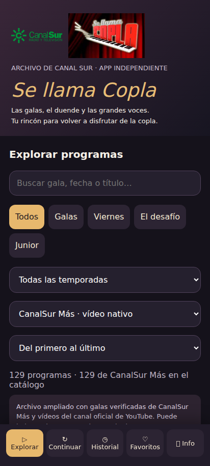

# Se llama Copla

Aplicación independiente para Android que reúne programas de **Se llama Copla** publicados por Canal Sur, organizados para verlos dentro de la app.

[Descargar APK](https://github.com/Habibitv/se-llama-copla/releases/latest) · Android 8 o posterior

## Funciones

- Catálogo de 309 vídeos: 129 de CanalSur Más y 180 del canal oficial de YouTube.
- Búsqueda y filtros por temporada, categoría y fuente.
- Reproducción integrada, pausa, barra de progreso y anterior/siguiente.
- Pantalla completa horizontal con controles superpuestos que se ocultan al reproducir.
- Historial, favoritos y continuación desde el minuto guardado.
- Interfaz ajustada al ancho de la pantalla.
- Icono de peineta con bandera andaluza.



## Instalación

1. Abre la última publicación y descarga `Se-llama-Copla-1.1.4.apk`.
2. Abre el archivo en tu móvil y permite instalar desde la aplicación que hayas usado para descargarlo.
3. Si ya tienes la app, instala la actualización encima, sin desinstalar, para conservar tu historial.

## Catálogo y privacidad

El catálogo reúne publicaciones oficiales disponibles; **no representa el archivo completo del programa**. Puede haber distintas publicaciones de una misma gala. La disponibilidad depende de las plataformas originales. CanalSur Más se reproduce mediante Media3/ExoPlayer; YouTube utiliza su reproductor oficial integrado.

No necesita cuenta en la app. Historial y favoritos se guardan en el dispositivo. Solo solicita el permiso de Internet. No descarga los programas ni incorpora credenciales del servicio de CanalSur Más.

## Código fuente y compilación

Descarga [Se-llama-Copla-proyecto.zip](Se-llama-Copla-proyecto.zip), descomprímelo y abre la carpeta `Copla` en Android Studio.

JDK 17, Gradle 8.10.2, Android Gradle Plugin 8.7.3 y Android SDK 35 (Build Tools 35.0.0).

Configura `sdk.dir` en tu `local.properties` y ejecuta:

```sh
gradle :app:assembleRelease
```

El proyecto utiliza la firma de desarrollo. Para distribuir tus propias actualizaciones, configura y conserva tu propio certificado. Las APK publicadas de esta app mantienen su firma entre versiones.

## Versión 1.1.4

Incluye el nuevo icono, el ajuste del ancho y las mejoras de pantalla completa y márgenes de Android. Compilación y firma verificadas. Probados filtros, búsqueda, historial, favoritos y navegación; sin desbordamiento horizontal a 320, 360, 412 y 768 píxeles. La última revisión del reproductor nativo está pendiente de validación en un dispositivo físico.

## Créditos

Aplicación independiente, sin afiliación con Canal Sur. Los vídeos, imágenes y marcas de Canal Sur y Se llama Copla pertenecen a sus titulares. El icono propio de la app está en `Copla/app/src/main/res/drawable/icon.xml` dentro del proyecto.
